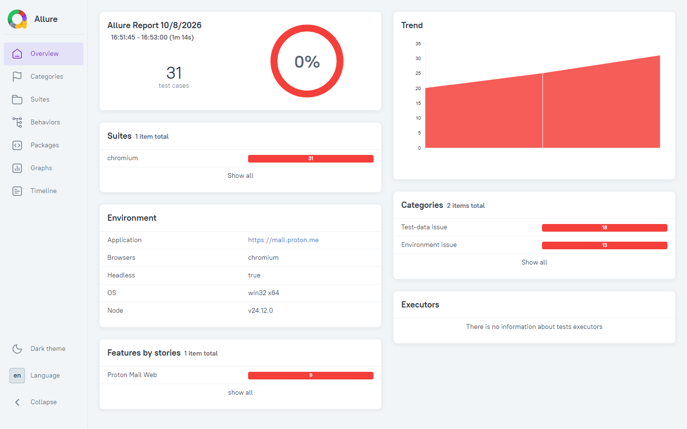
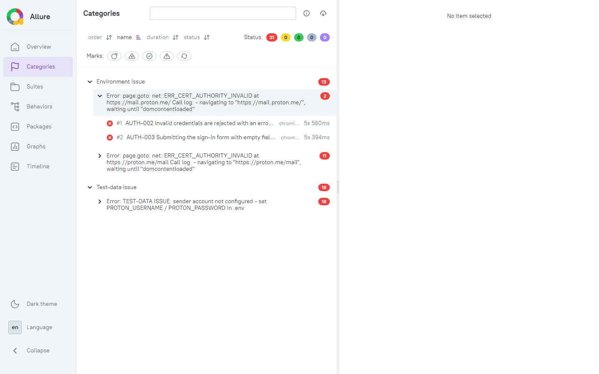
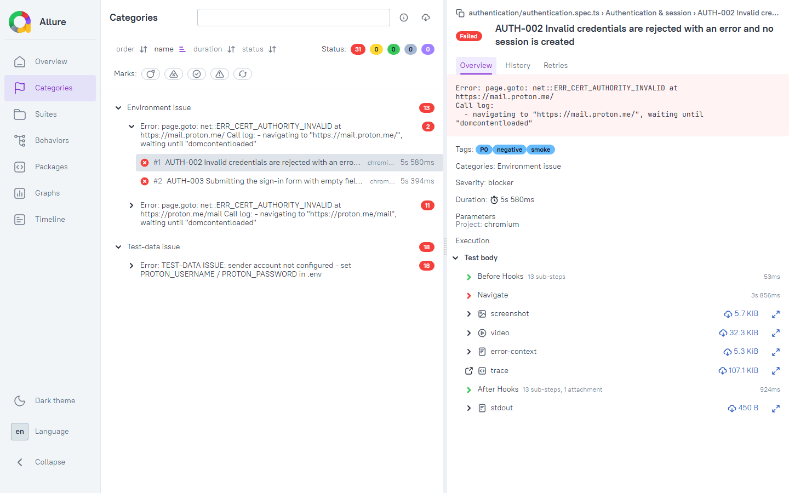
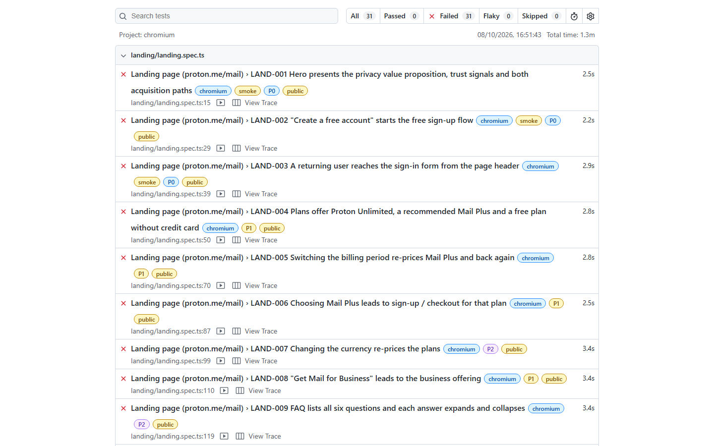
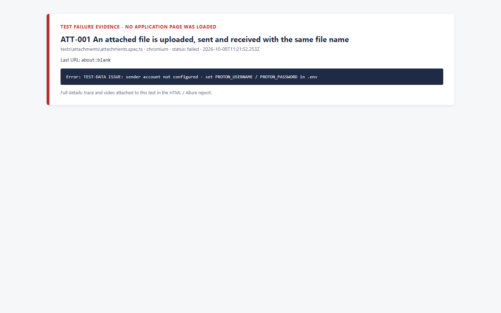
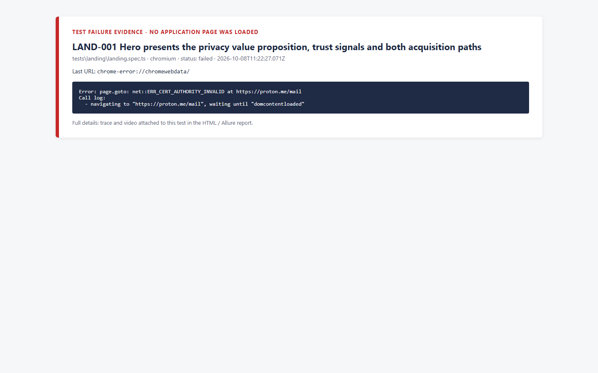

# Proton Mail Web - Automation Regression Suite

Playwright + TypeScript regression suite for **Proton Mail Web** (`https://proton.me/mail`), built for the Automation QA Engineer practical assessment.

**55 test cases designed · 31 automated scenarios (20 mailbox + 11 public landing page) · Allure + Playwright HTML reports · screenshot, trace and video on every failure.**

---

## Contents

1. [Submission checklist](#1-submission-checklist)
2. [Latest execution result](#2-latest-execution-result)
3. [How this suite was developed](#3-how-this-suite-was-developed)
4. [How it works](#4-how-it-works)
5. [Test cases (all 55)](#5-test-cases-all-55)
6. [Automated scenarios (31) and what they verify](#6-automated-scenarios-31-and-what-they-verify)
7. [Prerequisites and installation](#7-prerequisites-and-installation)
8. [Configuration and credentials](#8-configuration-and-credentials)
9. [Running tests](#9-running-tests)
10. [Reports: Allure, HTML, screenshots, traces](#10-reports-allure-html-screenshots-traces)
11. [Debugging and troubleshooting](#11-debugging-and-troubleshooting)
12. [Project structure](#12-project-structure)
13. [Known limitations](#13-known-limitations)
14. [Defects and findings](#14-defects-and-findings)
15. [Automation quality review (trade-off questions)](#15-automation-quality-review-trade-off-questions)
16. [CI/CD](#16-cicd)
17. [Git submission](#17-git-submission)

---

## 1. Submission checklist

| Assessment checklist item | Status | Where |
|---|---|---|
| Test strategy completed | Done | [docs/Test_Strategy.md](docs/Test_Strategy.md) |
| Detailed test cases included and prioritized | Done: 55 cases, P0-P3, with preconditions, data, steps, expected result, classification, reason | [test-cases/ProtonMail_TestCases.xlsx](test-cases/ProtonMail_TestCases.xlsx) · [.md](test-cases/ProtonMail_TestCases.md) · [section 5](#5-test-cases-all-55) |
| 15-20 high-value automated scenarios implemented | Done: 31 tests (20 mailbox incl. one data-driven pair + 11 public landing page) | `tests/` · [section 6](#6-automated-scenarios-31-and-what-they-verify) |
| Required categories covered | Done: every category at or above its minimum | [Traceability matrix](docs/Traceability_Matrix.md) |
| Negative and asynchronous scenarios included | Done: 5 negative (AUTH-002/003, COMP-002a/b, SEARCH-002 no-result) + 2 async (Undo Send, Scheduled) | [section 6](#6-automated-scenarios-31-and-what-they-verify) |
| Assertions validate actual behavior/state | Done: receiver-side content, folder membership, read state, BCC privacy, URL state, persistence after reload | [section 6](#6-automated-scenarios-31-and-what-they-verify) |
| Failure evidence and reporting available | Done: Allure + HTML report, screenshot/trace/video per failure, classified summary, masked logs | [section 10](#10-reports-allure-html-screenshots-traces) |
| README allows another engineer to run the suite | Done: this file, sections 7-11 | - |
| Defects/findings documented | Done: no product defect confirmed; limitations and risks recorded | [defects/Defect_Report.md](defects/Defect_Report.md) |
| Trade-off questions answered | Done | [section 15](#15-automation-quality-review-trade-off-questions) · [docs/Automation_Quality_Review.md](docs/Automation_Quality_Review.md) |
| Architecture note | Done | [docs/Architecture.md](docs/Architecture.md) |
| Test report | Done | [reports/Final_Execution_Summary.md](reports/Final_Execution_Summary.md) · [docs/Execution_Summary.md](docs/Execution_Summary.md) |
| Video walkthrough (4-5 min) | To be recorded by the candidate | - |

## 2. Latest execution result

Final run: 2026-10-08, Chromium, `npm run test:allure`. **All 31 tests executed; none skipped.**

| Total | Passed | Failed | Skipped | Duration |
|---|---|---|---|---|
| 31 | 0 | 31 | 0 | 81.7 s |

| Failure category | Tests | Reason |
|---|---|---|
| Test-data issue | 18 | No Proton test accounts configured in `.env` |
| Environment issue | 13 (LAND-001..011, AUTH-002, AUTH-003) | Proton Mail not reachable from the execution machine (`net::ERR_CERT_AUTHORITY_INVALID`) |

These failures concern the execution setup, not Proton Mail. Once `.env` contains two accounts and the machine can reach `*.proton.me`, the same command produces the functional results. Details: [docs/Execution_Summary.md](docs/Execution_Summary.md).

**Allure - overview**



**Allure - failures grouped by category**



**Allure - test detail with error, tags, severity, screenshot, video and trace**



**Playwright HTML report**



**Failure screenshots** (captured automatically for every failed test; when no application page could load, the framework renders a labelled failure card instead of a blank image)

| Test-data failure (ATT-001) | Environment failure (LAND-001) |
|---|---|
|  |  |

## 3. How this suite was developed

| Step | What was done | Output |
|---|---|---|
| 1. Analyse | Read the assessment end to end; extracted the scope areas (section 1), minimum categories (section 4), quality criteria and evaluation weights | Requirement list → [Traceability matrix](docs/Traceability_Matrix.md) |
| 2. Risk & strategy | Ranked areas by user impact and failure likelihood; decided what to automate, keep manual or not automate; defined data, synchronisation and evidence strategies | [Test strategy](docs/Test_Strategy.md) |
| 3. Test design | 55 test cases with positive, negative, boundary and state-transition coverage, each with P0-P3 priority and an automation classification with reason | [Test cases](test-cases/ProtonMail_TestCases.md) (single JSON source → `.xlsx` + `.md`) |
| 4. Architecture | Layered framework: specs → workflows → page objects → components, plus fixtures for sessions, two accounts, evidence and cleanup | [Architecture](docs/Architecture.md) |
| 5. Implementation | 31 tests across 9 spec files (incl. the public landing page); locators centralised; no fixed sleeps; unique data per run; cleanup registry | `tests/`, `workflows/`, `pages/`, `components/` |
| 6. Reporting | Allure (labels + failure categories), Playwright HTML, classified Markdown summary, screenshots/traces/videos, masked logs | `reports/` |
| 7. Execute → debug → fix → rerun | Six runs; nine automation issues found and fixed (typing, fixture order, version drift, blank screenshots...) | [Execution summary](docs/Execution_Summary.md) |
| 8. Document & finalise | README, quality review answers, defect report, traceability | `docs/`, `defects/` |

## 4. How it works

```
 npm run test:allure
        │
        ▼
 globalSetup ── run ID for unique data · reachability + credential check (informational)
        │
        ▼
 Playwright runner (2 workers) ──► tests/<area>/*.spec.ts      WHAT is verified
                                         │
                                         ▼
                                   workflows/                  business flows (send, deliver, draft, search, filter)
                                         │
                                         ▼
                                   pages/  +  components/      every locator lives here, once
                                         │
                                         ▼
                                   Proton Mail Web  (account A = sender page, account B = receiver context)
        │
        ▼
 reporters ──► Allure results ──► allure generate ──► reports/allure-report/
           ──► HTML report, JSON, Final_Execution_Summary.md, screenshots/traces/videos, logs
```

**Typical two-account test (COMP-001):**

```ts
test('COMP-001 Email sent by account A is delivered to account B ...', { tag: ['@smoke', '@P0', '@two-account'] },
  async ({ sender, receiver, email, cleanup }) => {
    const message = { to: [receiver.address], subject: TestData.subject('COMP-001'), body: TestData.body('COMP-001') };
    cleanup.trashMessage(receiver, Folder.Inbox, message.subject);   // runs even if the test fails

    await email.send(sender, message);                                // compose → send → "Message sent"

    await email.expectInSent(sender, message.subject);
    await email.expectDelivered(receiver, { subject: message.subject, from: sender.address, body: message.body });
  });
```

**Key mechanisms**

| Mechanism | How |
|---|---|
| Sessions | Each account signs in once; the session is cached in git-ignored `.auth/<role>.json` and reused; expired sessions re-authenticate automatically. This keeps runs fast and avoids sign-in rate limits |
| Two accounts | `sender` uses Playwright's `page`; `receiver` gets its own isolated browser context (with video) |
| Unique data | `Automation Assessment [PMA-<runId>] <TEST-ID> <random>`, so tests are independent and parallel-safe |
| Synchronisation | Auto-waiting, web-first `expect`, `waitForURL`, bounded `expect.toPass` polling for delivery; **no `waitForTimeout`** |
| Pop-ups | `page.addLocatorHandler` dismisses promotional/onboarding dialogs whenever they appear |
| Cleanup | `CleanupWorkflow` registry: trash test messages, delete drafts/filters, in reverse order, even after failure |
| Security | Credentials only from `.env`; logger masks passwords and e-mail local parts; CAPTCHA/2FA are never bypassed and raise `AUTHENTICATION LIMITATION` |
| Failure classification | `TEST-DATA ISSUE`, `AUTHENTICATION LIMITATION`, network errors → categories in Allure and in the summary |

## 5. Test cases (all 55)

Full details (preconditions, data, steps, expected result, reason): [ProtonMail_TestCases.xlsx](test-cases/ProtonMail_TestCases.xlsx) / [ProtonMail_TestCases.md](test-cases/ProtonMail_TestCases.md).

| ID | Feature | Scenario | Priority | Classification |
|---|---|---|---|---|
| LAND-001 | Landing page | Hero presents the privacy value proposition, trust signals and both acquisition paths | P0 | **Automated** |
| LAND-002 | Landing page | "Create a free account" starts the free sign-up flow | P0 | **Automated** |
| LAND-003 | Landing page | Returning user reaches the sign-in form from the page header | P0 | **Automated** |
| LAND-004 | Landing page | Plans offer Proton Unlimited, a recommended Mail Plus and a free plan without credit card | P1 | **Automated** |
| LAND-005 | Landing page | Switching billing period re-prices Mail Plus and restores the yearly price | P1 | **Automated** |
| LAND-006 | Landing page | Choosing Mail Plus leads to sign-up / checkout for that plan | P1 | **Automated** |
| LAND-007 | Landing page | Changing currency re-prices the plans | P2 | **Automated** |
| LAND-008 | Landing page | "Get Mail for Business" leads to the business offering | P1 | **Automated** |
| LAND-009 | Landing page | FAQ lists all six questions; answers expand and collapse | P2 | **Automated** |
| LAND-010 | Landing page | Footer exposes legal links, company identity, language selector and current copyright | P2 | **Automated** |
| LAND-011 | Landing page | Phone layout: menu reveals Sign in, hero usable, no horizontal scrolling | P2 | **Automated** |
| LAND-012 | Landing page | Feature carousel, imagery and visual design | P3 | Not worth automating |
| LAND-013 | Landing page | Page health: no console errors or failed first-party requests | P3 | Automate (backlog) |
| LAND-014 | Landing page | Page in other languages via the language selector | P3 | Manual / Exploratory |
| AUTH-001 | Authentication | Valid credentials open the mailbox; session survives a page reload | P0 | **Automated** |
| AUTH-002 | Authentication | Invalid credentials are rejected | P0 | **Automated** |
| AUTH-003 | Authentication | Empty sign-in form shows required-field validation | P2 | **Automated** |
| AUTH-004 | Authentication | Sign-out ends the session; Back does not reopen the mailbox | P1 | **Automated** |
| AUTH-005 | Authentication | Sign-in with 2FA (TOTP) enabled | P1 | Manual / Exploratory |
| AUTH-006 | Authentication | Repeated failed sign-ins trigger human verification / rate limiting | P2 | Manual / Exploratory |
| AUTH-007 | Authentication | Session revoked from another device signs this browser out | P2 | Manual / Exploratory |
| COMP-001 | Compose & send | Two-account send: B receives with correct sender, subject and body | P0 | **Automated** |
| COMP-002a | Compose & send | Send blocked for a malformed recipient address | P1 | **Automated** |
| COMP-002b | Compose & send | Send blocked when no recipient is given | P1 | **Automated** |
| COMP-003 | Compose & send | CC visible to recipients, BCC hidden | P1 | **Automated** |
| COMP-004 | Compose & send | Password-protected email to an external recipient | P2 | Manual / Exploratory |
| COMP-005 | Compose & send | Subject/body boundaries: empty subject, very long subject, unicode | P3 | Automate (backlog) |
| COMP-006 | Compose & send | Rich-text formatting renders consistently | P3 | Not worth automating |
| DRAFT-001 | Drafts | Auto-save without closing composer; persists after full reload | P1 | **Automated** |
| DRAFT-002 | Drafts | Reopen, edit, reload, send: draft moves from Drafts to Sent | P1 | **Automated** |
| DRAFT-003 | Drafts | Delete draft removes it permanently | P2 | **Automated** |
| DRAFT-004 | Drafts | Draft with attachment keeps the attachment after reload | P2 | Automate (backlog) |
| DRAFT-005 | Drafts | Same draft edited concurrently in two tabs | P3 | Manual / Exploratory |
| INBOX-001 | Inbox & actions | Unread → read on open → mark unread | P1 | **Automated** |
| INBOX-002 | Inbox & actions | Star / unstar updates Starred folder | P1 | **Automated** |
| INBOX-003 | Inbox & actions | Inbox → Archive → Trash → restore to Inbox | P1 | **Automated** |
| INBOX-004 | Inbox & actions | Bulk select and move several messages | P2 | Automate (backlog) |
| FOLDER-001 | Folders & labels | Create custom folder, move message, delete folder | P2 | Automate (backlog) |
| LABEL-001 | Folders & labels | Apply and remove a label | P2 | Automate (backlog) |
| SEARCH-001 | Search | Keyword search returns exactly the match; clear restores folder view | P1 | **Automated** |
| SEARCH-002 | Search | Advanced search: keyword AND sender (plus no-result case) | P1 | **Automated** |
| SEARCH-003 | Search | Date-range search | P3 | Manual / Exploratory |
| SEARCH-004 | Search | Body content search with local index enabled | P3 | Manual / Exploratory |
| FILTER-001 | Filters | Subject filter: matching → Archive; non-matching stays in Inbox | P1 | **Automated** |
| FILTER-002 | Filters | Disabled filter no longer applies; edit changes behaviour | P2 | Automate (backlog) |
| FILTER-003 | Filters | Sieve (advanced) filter syntax | P3 | Not worth automating |
| ATT-001 | Attachments | Upload, send and receive an attachment with the same file name | P1 | **Automated** |
| ATT-002 | Attachments | Remove attachment before sending | P2 | Automate (backlog) |
| ATT-003 | Attachments | Attachment over the size limit is rejected | P2 | Manual / Exploratory |
| ATT-004 | Attachments | Download received attachment and verify content | P2 | Automate (backlog) |
| ASYNC-001 | Async | Undo Send: transient undo state, restored composer, final send | P1 | **Automated** |
| ASYNC-002 | Async | Schedule for tomorrow, verify Scheduled state, cancel via Edit | P2 | **Automated** |
| ASYNC-003 | Async | Scheduled message actually delivered at the scheduled time | P2 | Manual / Exploratory |
| UX-001 | Cross-cutting | Visual layout, themes and responsive breakpoints | P3 | Not worth automating |
| A11Y-001 | Cross-cutting | Keyboard navigation and screen-reader labels | P2 | Manual / Exploratory |

**Totals:** 31 automated · 9 automate-backlog · 11 manual/exploratory · 4 not worth automating · P0: 6 · P1: 19 · P2: 20 · P3: 10.

## 6. Automated scenarios (31) and what they verify

**Public landing page `https://proton.me/mail` (no account needed).** This is the real entry point: a product page, not a login page.

| # | ID | Spec | Tags | Key assertions |
|---|---|---|---|---|
| L1 | LAND-001 | `landing` | @smoke @P0 @public | HTTP < 400; title "Proton Mail"; H1 "Secure email that protects your privacy"; encrypted/Switzerland value proposition; 3 trust signals; both CTAs visible |
| L2 | LAND-002 | `landing` | @smoke @P0 @public | "Create a free account" → Proton account sign-up (nothing submitted) |
| L3 | LAND-003 | `landing` | @smoke @P0 @public | Header "Sign in" → sign-in form with username, password, enabled button |
| L4 | LAND-004 | `landing` | @P1 @public | Unlimited, Mail Plus, Free cards each with CTA; Free = 0.00 + "No credit card required"; Mail Plus marked Recommended |
| L5 | LAND-005 | `landing` | @P1 @public | 12 months → note "every 12 months"; 1 month → different price, no note; back to 12 months → yearly price restored |
| L6 | LAND-006 | `landing` | @P1 @public | "Get Mail Plus" → account sign-up / checkout for the plan |
| L7 | LAND-007 | `landing` | @P2 @public | Currency USD → EUR: selector shows EUR, Mail Plus price in € |
| L8 | LAND-008 | `landing` | @P1 @public | "Get Mail for Business" → business page |
| L9 | LAND-009 | `landing` | @P2 @public | All 6 FAQ questions visible; "Is Proton Mail free?" expands then collapses |
| L10 | LAND-010 | `landing` | @P2 @public | Privacy Policy / Terms links to legal pages; Proton AG, Geneva; "© <current year> Proton AG"; language selector |
| L11 | LAND-011 | `landing` | @P2 @mobile @public | Phone profile: H1 in viewport, CTA visible, no horizontal scroll; menu reveals "Sign in" |

**Mail application (two accounts)**

| # | ID | Spec | Tags | Key assertions (business state) |
|---|---|---|---|---|
| 1 | AUTH-001 | `authentication` | @smoke @P0 | Lands on `/u/<n>/inbox`; after reload still signed in |
| 2 | AUTH-002 | `authentication` | @smoke @P0 @negative | "Incorrect login credentials"; stays on sign-in; no mailbox URL |
| 3 | AUTH-003 | `authentication` | @P2 @negative | "This field is required"; username focused; no navigation |
| 4 | AUTH-004 | `authentication` | @P1 | After sign-out, Back and direct `/inbox` both land on sign-in |
| 5 | COMP-001 | `compose` | @smoke @P0 @two-account | Sender: "Message sent" + in Sent. Receiver: sender address, subject, body |
| 6 | COMP-002a | `compose` | @P1 @negative | Malformed address: validation shown, composer open, nothing sent |
| 7 | COMP-002b | `compose` | @P1 @negative | No recipient: validation shown, composer open, nothing sent |
| 8 | COMP-003 | `compose` | @P1 @two-account | Receiver header shows CC address; BCC alias absent (privacy) |
| 9 | DRAFT-001 | `drafts` | @smoke @P1 | Draft listed while composer still open; after reload reopens with same subject/body |
| 10 | DRAFT-002 | `drafts` | @P1 | Edit survives reload; after send: gone from Drafts, present in Sent |
| 11 | DRAFT-003 | `drafts` | @P2 | Deleted draft absent, also after reload |
| 12 | INBOX-001 | `inbox` | @P1 @two-account | Row unread → read after opening → unread after "Mark as unread" |
| 13 | INBOX-002 | `inbox` | @P1 @two-account | In Starred after star; absent after unstar |
| 14 | INBOX-003 | `inbox` | @smoke @P1 @two-account | After each move: in target folder AND absent from source |
| 15 | SEARCH-001 | `search` | @smoke @P1 @two-account | Exactly 1 result; URL holds keyword; clear removes it and restores Inbox |
| 16 | SEARCH-002 | `search` | @P1 @two-account | keyword + From=A returns only A's message (decoy from B excluded); unknown sender → "No results" |
| 17 | FILTER-001 | `filters` | @P1 @two-account | Matching mail only in Archive; non-matching in Inbox; filter deleted afterwards |
| 18 | ATT-001 | `attachments` | @smoke @P1 @two-account | Upload finished in composer; in Sent; receiver sees `attachment.txt` |
| 19 | ASYNC-001 | `async` | @smoke @P1 | Undo offered → composer restored, not in Sent → re-send → Undo disappears → in Sent |
| 20 | ASYNC-002 | `async` | @P2 | In Scheduled with banner → Edit → back to draft, absent from Scheduled |

Plus 11 public landing-page tests. Minimums from the assessment: Authentication 2 (have 4) · Compose 3 (4) · Drafts 2 (3) · Inbox 3 (3) · Search 2 (2) · Filters 1 (1) · Async 1 (2) · Attachments 1 (1).

## 7. Prerequisites and installation

| Requirement | Version / note |
|---|---|
| Node.js | ≥ 18.18 (developed on 24.12) |
| npm | bundled with Node |
| Java | 8+ (only for generating the Allure report; developed with 17) |
| Network | Direct access to `*.proton.me` |
| Test accounts | **Two dedicated Proton accounts** (free plan is fine): 2FA disabled, English UI, default settings (Undo Send on), no other custom filter on account B. Never use personal accounts: the suite sends, moves and deletes mail |

```bash
npm ci
npx playwright install chromium        # add firefox webkit for cross-browser runs
```

Pinned dependencies: `@playwright/test 1.63.0`, `typescript 5.6.3`, `allure-playwright 3.12.2`, `allure-commandline 2.46.1`, `dotenv 16.4.5`, `exceljs 4.4.0`, `cross-env 7.0.3`.

## 8. Configuration and credentials

```bash
cp .env.example .env    # then edit .env (git-ignored)
```

| Variable | Required | Description |
|---|---|---|
| `PROTON_USERNAME` / `PROTON_PASSWORD` | yes | Account A (sender), full address |
| `PROTON_RECEIVER_USERNAME` / `PROTON_RECEIVER_PASSWORD` | yes | Account B (receiver) |
| `BASE_URL` / `MAIL_URL` / `ACCOUNT_URL` | no | Application URLs |
| `BROWSER` | no | `chromium` (default), `firefox`, `webkit`, `all` |
| `HEADLESS` | no | `true` (default) / `false` |
| `WORKERS` | no | Parallel workers (default 2, CI 1) |
| `DELIVERY_TIMEOUT_MS` | no | Max wait for cross-account delivery (default 120000) |
| `SKIP_PREFLIGHT` | no | `true` to skip the informational reachability check |
| `LOG_LEVEL` | no | `debug`, `info`, `warn`, `error` |

If credentials are missing, the affected tests **fail** with `TEST-DATA ISSUE: ... not configured`; tests are never skipped. Secrets never appear in logs or reports, because passwords and e-mail local parts are masked.

## 9. Running tests

| Purpose | Command |
|---|---|
| **Full regression + Allure report** | `npm run test:allure` |
| Full regression (HTML report only) | `npm test` |
| Smoke | `npm run test:smoke` |
| P0 only | `npm run test:p0` |
| One area | `npx playwright test tests/compose` |
| One test | `npx playwright test -g "COMP-001"` |
| Smoke + Allure | `npm run test:allure -- --grep @smoke` |
| Headed, single worker | `npm run test:headed` |
| Step-through debugger | `npm run test:debug` |
| Firefox / WebKit / all | `cross-env BROWSER=firefox npx playwright test` · `npm run test:all-browsers` |
| Type check | `npm run typecheck` |
| Rebuild test-case workbook | `npm run testcases:build` |

## 10. Reports: Allure, HTML, screenshots, traces

| Output | Location | Open with |
|---|---|---|
| **Allure report** | `reports/allure-report/index.html` | `npm run allure:open` |
| Allure raw results | `reports/allure-results/` | `npm run allure:generate` |
| Playwright HTML report | `reports/html/index.html` | `npm run report` |
| Classified summary | `reports/Final_Execution_Summary.md` | any Markdown viewer |
| Failure screenshots | `reports/screenshots/` | also inside Allure and HTML |
| Traces | `reports/traces/<ID>-trace-retry<N>.zip` | `npx playwright show-trace <file>` |
| Videos | `reports/videos/` | also inside Allure and HTML |
| Logs (masked) | `reports/logs/execution-<date>.log` | - |

Allure features used: **epic** (Proton Mail Web), **feature** (spec area), **story** (test ID), **severity** from priority (P0 blocker, P1 critical, P2 normal, P3 minor), Playwright tags, environment widget, history trend across runs, and **categories**: Environment issue, Test-data issue, Authentication limitation, Locator/synchronization/application (needs triage).

## 11. Debugging and troubleshooting

**Debugging a failure**

1. Allure → *Categories* shows the cause group. Open the test to see the error, screenshot, video and trace.
2. Open the trace (`npx playwright show-trace`): DOM snapshot per step, network, console.
3. Re-run only that test, headed: `npx playwright test -g "<ID>" --headed --workers=1`, or with `--debug`.
4. If it is a locator problem, fix it in the one component/page that owns that locator.

| Symptom | Cause | Action |
|---|---|---|
| `TEST-DATA ISSUE: ... not configured` | Credentials missing | Fill `.env` |
| `TEST-DATA ISSUE: Proton rejected the ... credentials` | Wrong password / address | Check `.env` |
| `net::ERR_...` on navigation | Proton Mail not reachable from this machine | Use a machine with direct access to `*.proton.me` |
| `browserType.launch: Executable doesn't exist` | Browser not installed for this Playwright version | `npx playwright install chromium` |
| `AUTHENTICATION LIMITATION: ... human verification` | Too many sign-ins from this IP | Wait and re-run; sessions are cached. Never bypass |
| `AUTHENTICATION LIMITATION: ... two-factor` | Account has 2FA | Use accounts without 2FA |
| Delivery timeout | Slow delivery | Increase `DELIVERY_TIMEOUT_MS` |
| FILTER-001 cannot create filter | Free-plan limit reached by a manual filter | Delete other filters on account B |
| Allure report not generated | Java missing | Install Java 8+ and ensure it is on `PATH` |
| Stale session | Session revoked | Delete `.auth/` (recreated automatically) |

## 12. Project structure

```
proton-mail-automation/
├── playwright.config.ts        Runner: projects, reporters (list, HTML, JSON, summary, Allure), evidence policy
├── config/
│   ├── environment.ts          Typed configuration from .env (single source of truth)
│   └── globalSetup.ts          Run ID, fresh Allure results, reachability + credential check
├── tests/<area>/*.spec.ts      landing, authentication, compose, drafts, inbox, search, filters, attachments, async
├── workflows/                  Authentication, Email, Draft, Search, Filter, Cleanup
├── pages/                      Landing, Login, Mailbox, Compose, Draft, Search, Filter, Settings
├── components/                 Navigation, MessageRow, ComposeDialog, Notification, SearchControls
├── fixtures/
│   ├── testFixtures.ts         sender/receiver, workflows, Allure labels, evidence, cleanup
│   └── accountFixtures.ts      MailUser, session caching, overlay handling, second context
├── utils/                      testDataGenerator, logger (masking), screenshotUtils (failure card),
│                               environmentValidator, executionSummaryReporter
├── test-data/                  testData.json, attachment.txt
├── test-cases/                 testCases.source.json → ProtonMail_TestCases.xlsx / .md
├── scripts/                    build-test-cases.mjs, run-with-allure.mjs
├── reports/                    allure-results/ allure-report/ html/ screenshots/ traces/ videos/ logs/
│                               test-results/ + Final_Execution_Summary.md
├── docs/                       Test_Strategy, Architecture, Automation_Quality_Review,
│                               Traceability_Matrix, Execution_Summary, images/
└── defects/Defect_Report.md
```

## 13. Known limitations

- **Landing-page tests are built from a capture of the live page** (exact headline, CTA, plan, FAQ and footer texts), but have not yet run against it from this machine. Small selector adjustments (e.g. the billing toggle or currency control role) may be needed on the first run with network access.
- **No functional pass/fail data yet.** All 31 tests ran, but none could reach a signed-in Proton Mail session: no test accounts were available, and Proton Mail was not reachable from the execution machine. The framework, reports and evidence pipeline were executed and verified end to end.
- Locators for signed-in screens follow Proton's public web client structure (roles, labels, `data-testid` hooks) and are not yet confirmed against a live session. They are centralised, so adjustments after the first live run are contained.
- Manual by design: 2FA, CAPTCHA/rate limiting, password-protected external mail, real scheduled delivery, date-range and body search, large attachments.
- Free plan: one custom filter; FILTER-001 removes stale suite filters before it runs.

## 14. Defects and findings

No confirmed application defect was identified within the executed assessment scope. Limitations (no reachable application, no accounts) and automation risks (sign-in rate limits, metadata-only search, filter limit, pop-ups) are documented in [defects/Defect_Report.md](defects/Defect_Report.md).

## 15. Automation quality review (trade-off questions)

Full answers: [docs/Automation_Quality_Review.md](docs/Automation_Quality_Review.md).

1. **What was deliberately NOT automated, and why?** 2FA (would store a TOTP secret), CAPTCHA/rate limiting (security control, never bypassed), password-protected external mail (needs an external mailbox), visual/rich-text rendering (brittle pixel checks), date-range and body search (aged data / local index), oversized attachments (slow, costly), real scheduled delivery (wall-clock wait). Eight more cases are valuable backlog, deferred to keep about 20 reliable tests.
2. **5 tests for every PR / nightly?** PR: AUTH-002, AUTH-001, COMP-001, DRAFT-001, INBOX-003, the widest-impact P0/P1 journeys in about 5 minutes. Nightly: the full suite plus Firefox/WebKit. Trade-off: fast, trusted PR feedback vs complete but slower coverage of multi-delivery and timing flows.
3. **Passes locally, fails intermittently in CI?** Start from the trace and video; classify the failure; compare environments (headless, viewport, CPU, timezone, IP reputation, shared accounts); reproduce with `--repeat-each` under CI settings; check isolation; fix the cause (state waits, unique data), not the symptom (timeouts/retries).
4. **Reducing flakiness with a changing UI?** Intent-based locators with `data-testid` fallback in one place, state-based waits only, central pop-up handling, unique data, smoke-tag fast feedback, a test-hook contract with developers, quarantine with tickets.
5. **Scaling 20 → 200+ tests?** Strict layering, data-driven specs, API/IMAP-level seeding, an account pool per worker, tag-based pipelines with sharding, ownership and flake dashboards, regular pruning.

## 16. CI/CD

CI workflow was intentionally treated as optional based on the assessment requirements, which identify it as a bonus engineering practice. The submitted solution prioritises deterministic local execution, automation quality, reporting and maintainability. The suite is CI-ready: headless by default; `CI=true` gives 1 worker, 1 visible retry and `forbidOnly`; all configuration comes from environment variables / secrets.

## 17. Git submission

```bash
git init
git add .
git commit -m "Proton Mail automation assessment: Playwright + TypeScript suite"
git remote add origin <repository-url>
git push -u origin main
```

`.gitignore` excludes `.env`, `.auth/`, `node_modules/`, Playwright/Allure output folders and generated run artifacts. Committed on purpose: `reports/Final_Execution_Summary.md` (test report) and `docs/images/` (report screenshots).
